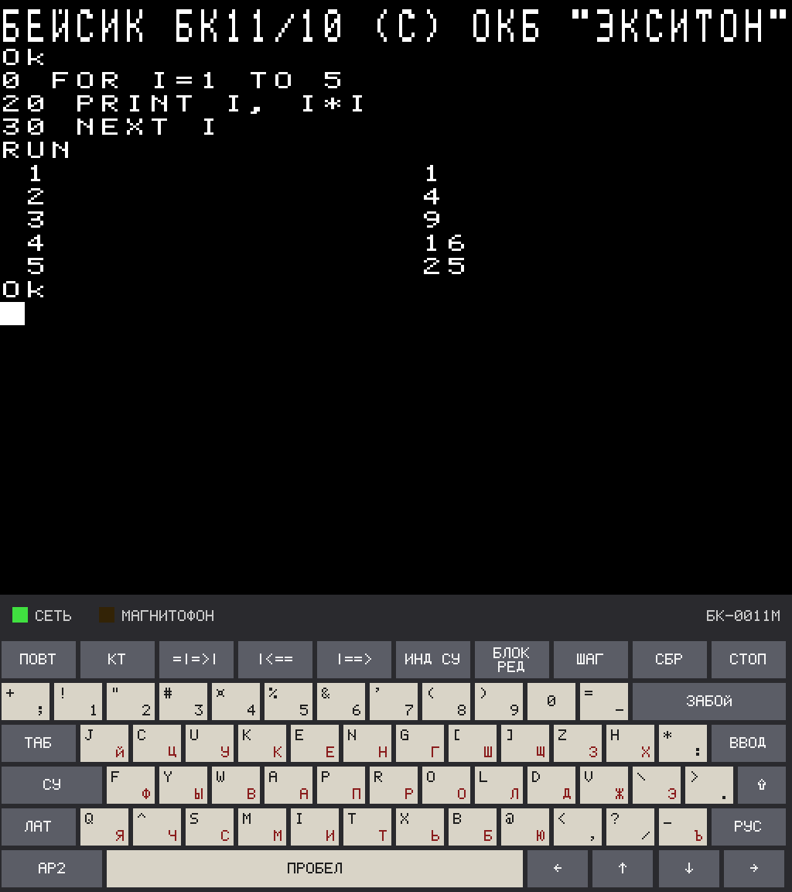
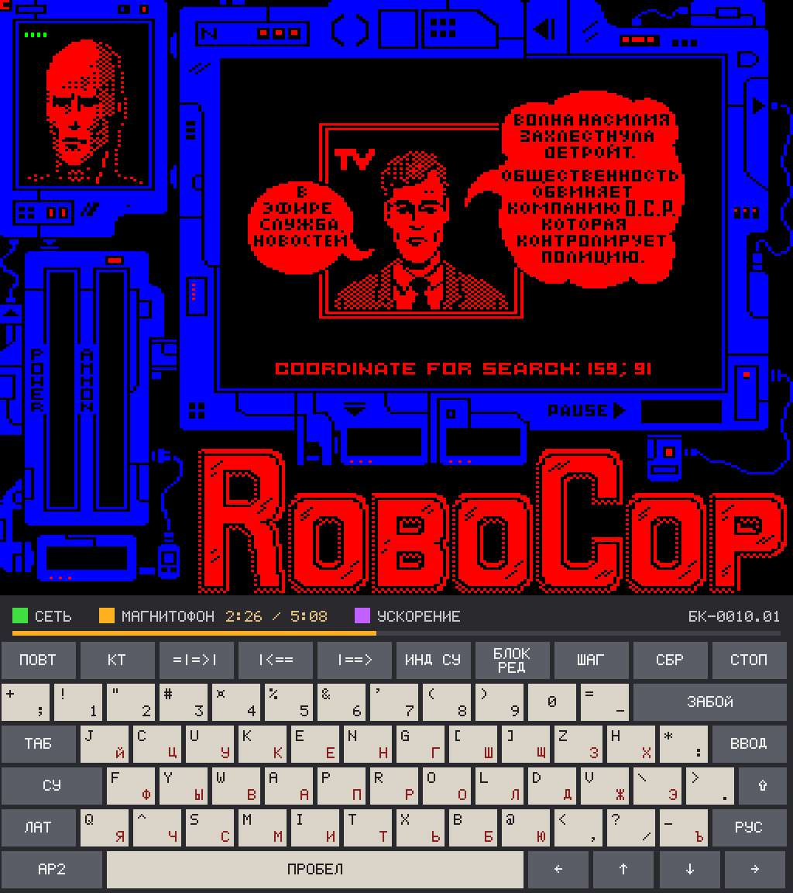
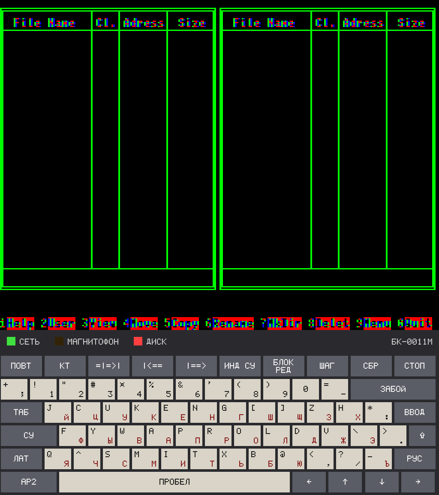
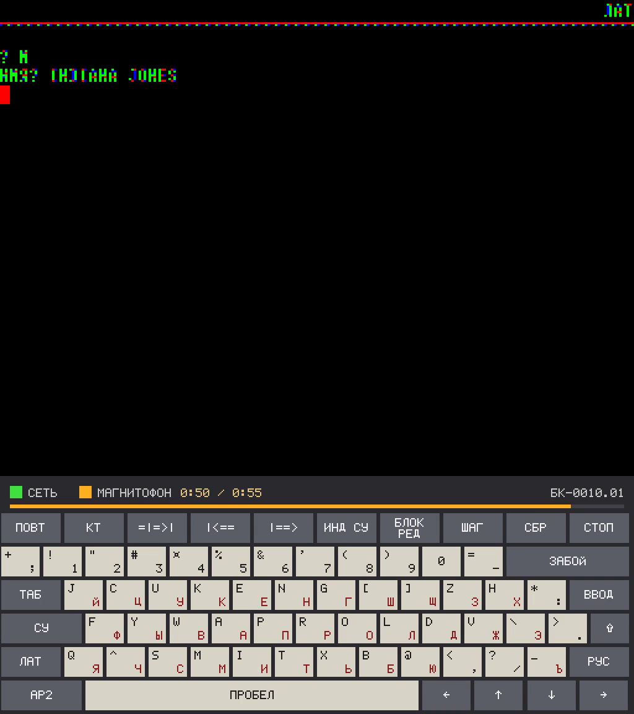
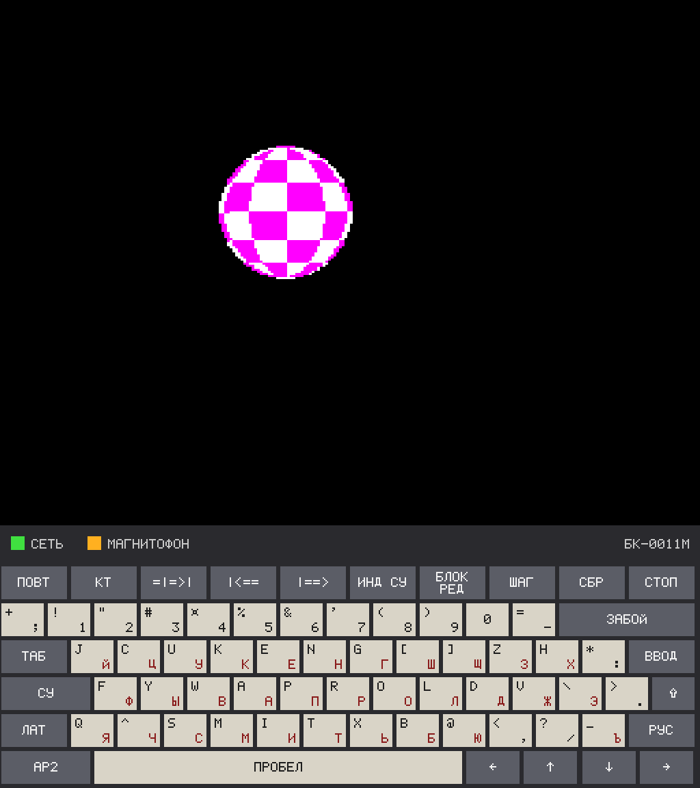
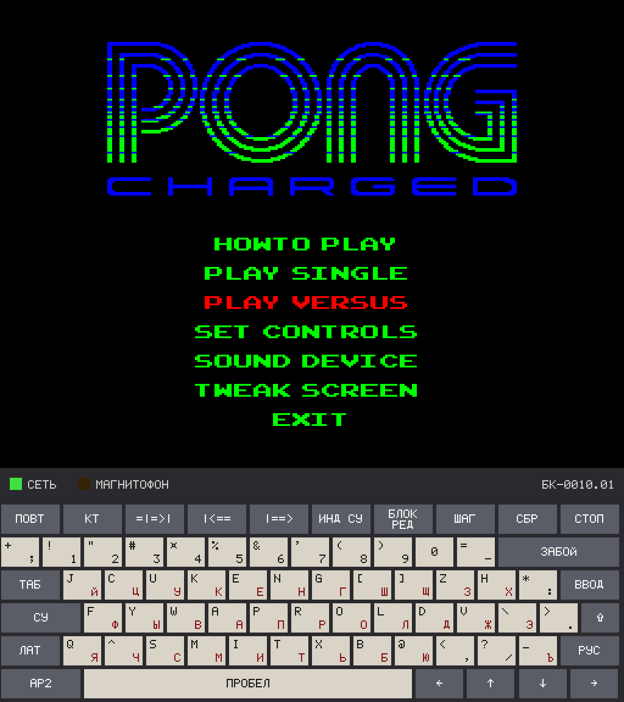

# BK-0011M

An emulator of the Soviet Elektronika BK home computers, the BK-0011M,
BK-0010.01 and BK-0010, written in Rust. The BK is a PDP-11: its K1801VM1
processor runs the instruction set of DEC's minicomputers. The emulator runs
the machines' original ROMs, so BASIC, FOCAL, the monitors and the system
software behave as they did, and BK software from tape and disk runs on it,
copy-protected cassettes included.

It comes with English guides to the computers, written from the original
Soviet manuals: using the machine, BASIC, FOCAL, the monitors, machine code
and system programming ([docs/](docs/README.md)).

<p align="center">
  
  
  
</p>

BASIC on the BK-0011M; Robocop (Smash corp., 1992), a copy-protected
game, loading from its tape on the BK-0010.01, with the МАГНИТОФОН light,
the time played, the bar over the keys and УСКОРЕНИЕ (fast-forwarding);
ANDOS's file manager reading a disk, with the ДИСК light.

<p align="center">
  <a href="docs/images/indiana-jones.mp4"></a>
  
  
</p>

▶ [Video](docs/images/indiana-jones.mp4) (MP4, 1:45): Indiana Jones (Smash
corp., 1991) loading from its tape, heard as the cassette recorder played
it, then its intro with music, recorded with `bk --video`.
[Boing Ball](https://github.com/Manwe-SandS/BoingBall) and
[PONG Charged](https://github.com/Manwe-SandS/PONG-Charged), MIT-licensed
homebrew, on the BK-0011M and the BK-0010.01.

## What this project adds

Research, each finding recorded with its evidence in
[docs/hardware-reference.md](docs/hardware-reference.md) and
[tools/vm1-timing/](tools/vm1-timing/README.md):

- **The CPU's timing, measured.** bkbtl times each instruction from tables
  measured on real BK-0010s. `bk` instead reproduces, bus cycle by bus
  cycle, a chip-level model of the K1801VM1 (reverse-engineered by
  @1801BM1) running against a model of the BK's memory controller, and a
  test replays the recorded bus logs. This also shows why the BK-0011M,
  clocked a third faster than the BK-0010, runs programs only about 15%
  faster: its memory controller still runs at the old speed.
- **The order of traps and interrupts**, settled on the same model.
- **The ROMs' speed and the tape input's polarity**, worked out from
  copy-protected games: four take their decryption key from the CPU's
  timer and decrypt correctly only if the ROM replies in 1 clock.
- **How 19 copy-protected tapes work**, taken apart game by game
  ([software/tapes/protected/](software/tapes/protected/README.md#how-the-protection-works)).
- **English guides** to the BK, written from the Soviet manuals, and
  commented disassembly listings of every ROM.

Features:

- **Tapes as the machine read them**: real recordings go through the ROM
  with the recorder modeled (its motor relay, the signal's polarity, its
  sound), all 19 protected games load, and `--wav2bin` reads recordings
  into `.bin` files through the real ROM.
- **Built for testing**: headless runs that type, take screenshots and
  record video with sound; save states; a debugger with the ROM listings'
  symbols; a test suite that plays real games and protected tapes. It runs
  on macOS, Linux and Windows.

## Features

- **Three models**: the BK-0011M (128 KB paged RAM, 4 MHz, BOS and BASIC),
  the BK-0010.01 (monitor and BASIC) and the BK-0010 (monitor, FOCAL and the
  test ROM).
- **The CPU**: every K1801VM1 instruction, its traps and interrupt order and
  its timer, timed bus cycle by bus cycle as a chip-level model of the
  processor does, with memory waits following the time slots of the BK's
  memory controller and the tape and other devices clocked to each access.
- **Video**: the 512×256 mono and 256×256 four-color screen, hardware
  scrolling, the BK-0011M's 16 palettes and two screen pages; switchable
  color and mono monitors.
- **Sound**: the built-in speaker, an AY-3-8910 and a Covox on the parallel
  port, and the tape as the cassette recorder plays it.
- **Joystick** on the parallel port, from the numeric keypad or a gamepad,
  or a **printer** there that writes to a text file; the BK-0010's
  **serial line**, to and from files.
- **Tape**: real recordings (`.wav` or `.mp3`, gzipped or not) load through
  the ROM, fast-forwarded or at their real speed. The recorder's motor relay
  and the signal's polarity are emulated, and all 19
  [copy-protected games](software/tapes/protected/README.md) in the
  repository load. Everything the BK writes can be recorded; "fast tape"
  reads and writes `.bin` files on the host instead, and `.bin` files
  convert to and from recordings.
- **Disks**: the floppy controller on both models at the level of raw
  tracks (with the BK-0010's extra 16 KB of RAM), up to four 800 KB disk
  images; operating systems such as ANDOS and CSIDOS boot.
- **The BK keyboard on screen**, lighting up as you type and clickable,
  with indicator lights, a power switch and a bar showing how far the tape
  has played; keys remappable from an INI file.
- **Save states**, a **debugger** (breakpoints, conditional or on a system
  call; watchpoints; stepping over calls; disassembly with the ROMs'
  symbols; tracing), and **headless runs** for scripting and tests, which
  can save screenshots, the sound, or a video of the whole run.
- **Tools**: a MACRO-11 assembler and disassembler, and commented
  disassembly listings of every ROM and of the software in the repository.

## Getting started

Download `bk` for macOS, Linux or Windows from the
[latest release](https://github.com/kromych/BK-0011M/releases/latest). It
needs the BK's ROM images, which the release doesn't include: they are in
this repository's `roms/` folder, the same files the bkbtl emulator's
repository publishes in its
[`roms`](https://github.com/nzeemin/bkbtl/tree/master/roms) folder (names
and checksums in [docs/emulator.md](docs/emulator.md#the-rom-files)). Run
`bk` from the folder holding `roms/`, or give `--roms DIR`. To build it
yourself, `cargo build --release` makes `target/release/bk`.

```sh
bk                                     # a BK-0011M, booting into BASIC
bk --bk0010                            # a BK-0010.01
bk --bk0010 --focal                    # a BK-0010 with FOCAL
bk --bk0010 --load software/klad.bin
bk --disk software/ANDOS330.DSK        # boot ANDOS on the BK-0011M
bk --bk0010 --tape software/tapes/protected/Ferrari.wav.gz
```

Try BASIC:

```
10 FOR I=1 TO 5
20 PRINT I, I*I
30 NEXT I
RUN
```

To load a game from tape, start with the recording in the recorder (the
last line above), type `MONIT` in BASIC, then at the monitor's `?` type
`M`, the file's name (`FERRARI`) and ВВОД. The tape plays, fast-forwarded,
and the game's own loader takes over.

Keys: letters, digits and punctuation are where they are on a US keyboard;
Enter is ВВОД, left Ctrl АР2, right Ctrl СУ, Home and End ЛАТ and РУС, Esc
СТОП, F1–F9 the BK's function keys, and the numeric keypad (or a gamepad)
a joystick. Under the screen, a picture of the BK keyboard lights the keys
as you type and can be clicked, beside lights for power, the tape motor and
the disk. Alt (Cmd on a Mac) gives the emulator's commands:

| Alt+ | |
|---|---|
| O | open a program, tape, disk image or saved state |
| S, L | save the state, load it |
| D | stop in the debugger |
| V | type the clipboard's text into the BK |
| F | fast-forward the tape being read (it also runs fast by itself) |
| M | switch between the color and mono monitors |
| T | hear the tape; it then plays at its real speed |
| R | the recorder's motor control on or off (`--no-motor-control`) |
| I | invert the tape signal (`--invert-tape`) |

## Command-line options

`bk --help` lists them; [docs/emulator.md](docs/emulator.md) explains them
in detail. With any of `--frames`, `--type`, `--screenshot`, `--video`,
`--wav` or `--save-state`, `bk` runs headless: no window, as fast as it
can, for scripts and tests.

| Machine | |
|---|---|
| `--bk0010` | a BK-0010.01 (monitor and BASIC) instead of a BK-0011M |
| `--focal` | with `--bk0010`: the original BK-0010, with FOCAL instead of BASIC |
| `--mono` | the black-and-white monitor instead of color |
| `--roms DIR` | where the ROM files are (default `./roms`) |

| Programs and disks | |
|---|---|
| `--load FILE` | load a `.bin` program after booting and start it |
| `--start ADDR` | its start address, octal (default: the load address, or 1000 if that's lower) |
| `--files DIR` | fast tape: a program loading or saving a named file uses `.bin` files in DIR |
| `--fdd` | the floppy controller fitted |
| `--disk FILE` | a disk image (800 KB, `.img`, `.bkd`, `.dsk`) in the next drive, 0 to 3; implies `--fdd`. Changes are written back on exit unless the file is read-only |

| Tape | |
|---|---|
| `--tape FILE` | a recording (`.wav` or `.mp3`, either gzipped) in the recorder; it plays while the BK runs the motor |
| `--record FILE.wav` | record what the BK writes to tape |
| `--tape-sound` | hear the tape, which then plays at its real speed |
| `--no-motor-control` | the recorder isn't wired to the BK's motor relay: once started, the tape plays to its end, as some protected tapes need |
| `--invert-tape` | invert the recording's signal, for loaders that need the other polarity |
| `--bin2wav FILE.bin OUT.wav` | write a program as a recording in the standard format, and exit |
| `--tape-name NAME` | the name on the tape for `--bin2wav` |
| `--wav2bin FILE DIR` | read every file on a recording through the BK-0010 monitor ROM into DIR, and exit |

| Devices and sound | |
|---|---|
| `--ay` | an AY-3-8910 sound chip on the parallel port |
| `--covox` | a Covox (8-bit DAC) on the parallel port |
| `--printer FILE` | a printer on the parallel port: what the BK prints is added to FILE as text |
| `--serial-in FILE`, `--serial-out FILE` | BK-0010: the serial line's far end sends FILE, or what the BK sends is added to FILE |
| `--irq2-50hz` | BK-0010: a 50 Hz interrupt on vector 100 once a program has set it |
| `--mute` | no sound |

| States, keys and debugging | |
|---|---|
| `--state FILE` | where Alt+S saves the state and Alt+L loads it |
| `--restore FILE` | start from a saved state |
| `--keys FILE` | remap the keyboard from an INI file (default `bk-keys.ini`, if there is one) |
| `--write-keys FILE` | write the key map in use as an INI file, and exit |
| `--debug` | start stopped in the debugger (`h` for help); headless, it reads commands from stdin |
| `--symbols FILE` | names for the debugger (`NAME = ADDR` lines); repeatable |

| Headless runs | |
|---|---|
| `--frames N` | run N frames of 20 ms (default 100), then exit |
| `--type TEXT` | type TEXT after booting (`\n` Enter, `\NNN` a key code in octal, `\p` a 1-second pause) |
| `--wait N` | frames to run after typing (default 50) |
| `--screenshot FILE` | save the screen as PNG when done |
| `--video FILE` | record the whole run, picture and sound, as an MP4 (needs ffmpeg) |
| `--panel` | with `--screenshot` or `--video`: include the keyboard panel |
| `--wav FILE` | save the sound as a WAV file |
| `--save-state FILE` | save the machine state when done |

## Software to try

| | |
|---|---|
| [software/README.md](software/README.md) | programs and disks with the command line for each: games (Клад, King's Valley, Digger, Krakout, Saboteur 2, Miami Cobra), homebrew, ANDOS and CSIDOS |
| [software/tapes/protected/](software/tapes/protected/README.md) | 19 copy-protected games on tape (Ferrari, Indiana Jones, Robocop, Terminator, Exolon and more), how to load each, and [how each protection works](software/tapes/protected/README.md#how-the-protection-works) |
| [software/tapes/](software/tapes/README.md) | real cassette recordings of BK-0010.01 game sets, damaged as cassettes are |
| [software/bkemu/](software/bkemu/README.md) | programs, disks and tapes from gid's BKEmu emulator: Boulder Dash, a K1801VM1 test, ANDOS and CSIDOS work disks |

The protected tapes are a short course in how cassettes were copy-protected
in the early 1990s: loaders of their own reading headerless blocks,
encrypted code that decrypts itself through traps, files that overwrite the
monitor's tape settings as they load, the tape motor stopped mid-load, a
decryption key taken from the CPU's timer. Their README takes each game
apart; [docs/hardware-reference.md](docs/hardware-reference.md) records
what they showed about the real machine's timing.

## Documentation

| Guide | Contents |
|---|---|
| [docs/emulator.md](docs/emulator.md) | running the emulator, loading software, save states, the debugger |
| [docs/machine.md](docs/machine.md) | the computers, their hardware and their ROMs |
| [docs/monitor.md](docs/monitor.md) | the monitors, the keyboard and the screen |
| [docs/basic.md](docs/basic.md) | BASIC |
| [docs/focal.md](docs/focal.md) | FOCAL |
| [docs/machine-code.md](docs/machine-code.md) | the processor, the assembler, first programs |
| [docs/system-programming.md](docs/system-programming.md) | system calls, interrupts, devices, memory |
| [docs/hardware-reference.md](docs/hardware-reference.md) | register-level detail, as implemented, with sources |
| [software/tapes/protected/](software/tapes/protected/README.md#how-the-protection-works) | how copy protection on BK tapes worked, game by game |
| [docs/manuals/](docs/manuals/README.md) | the original manuals (Russian) |

## Repository layout

| Path | Contents |
|---|---|
| `crates/vm1` | the K1801VM1 CPU: decoder, executor, timing, disassembler, assembler. No I/O |
| `crates/bk` | the machine: memory and paging, devices, video, sound, tape, floppy, save states, debugger. No window, sound or file-system dependencies |
| `crates/bk-desktop` | the `bk` program: window (winit, softbuffer), sound (cpal), options |
| `crates/romdis` | writes commented disassembly listings of the ROMs and of the programs in `software/`, on disks and tapes too |
| `annotations/` | names and comments for the listings (system calls from the manuals) |
| `tools/mkandos.py` | makes an ANDOS boot disk holding BK programs |
| `tools/vm1-timing/` | measures the CPU's bus cycles on the MiST FPGA core's chip-level VM1 model, under Verilator |
| `docs/` | the guides and the original manuals |
| `roms/` | the ROM images (`mist/`: the MiST core's combined images); [roms/README.md](roms/README.md) says how to start each |
| `software/` | programs, disk images and tape recordings ([software/README.md](software/README.md)); `tapes/` real cassettes ([README](software/tapes/README.md)), `tapes/protected/` copy-protected games ([README](software/tapes/protected/README.md)), `bkemu/` files from BKEmu ([README](software/bkemu/README.md)) |

Git-ignored: `listings/` (generated by `cargo run -p romdis`).

## Testing

```sh
cargo test
```

The suite covers the CPU instruction by instruction, every opcode's
disassembly and reassembly, the devices, the firmware booting on each
model, BASIC and tape round trips, real games, protected tapes, a disk
boot, save states, the debugger, and seeded stress tests: random programs
hammering every device, damaged save states, random debugger commands, and
games played with random keys and replayed from a mid-game save
(`BK_STRESS=N` makes them bigger, `BK_STRESS_SEED` changes the seed). Tests
that need the ROMs or software files skip themselves when they're missing.

## Accuracy and limitations

Timing is measured, not guessed: `tools/vm1-timing` runs the MiST core's
reverse-engineered VM1 with a model of the BK's memory controller, and the
emulator's CPU reproduces its bus cycles exactly. The same harness settled
the order in which the VM1 takes traps and interrupts. How fast the ROMs
reply isn't measured but inferred from protected games, four of which take
their decryption key from the CPU's timer; with that timing all 19
protected games load (one, Перевал, only as far as its loader) and real
cassette recordings decode through the ROM.
[docs/hardware-reference.md](docs/hardware-reference.md) records the
evidence and marks the details that still rest on a single source
(**[verify]**).

Not emulated: the BK-0011 (only the BK-0011M), the A16M, SMK and Samara
disk controllers and hard disks, the mouse, the serial registers of the
school model (BK-0010Ш), and the analog imperfections of a TV. Turbo-format
tapes need their own loader, and BKEmu's `.tap` tape format isn't read.

## Credits and thanks

`bk` stands on other people's work. Thank you to:

- @1801BM1 (Vslav), who reverse-engineered the K1801VM1 down to its logic
  matrices: the timing of `bk`'s CPU was measured on that model.
- @sorgelig (Alexey Melnikov), for the MiST BK0011M FPGA core
  (<https://github.com/sorgelig/BK0011M>), which puts that model in a
  working BK with a model of its memory controller; `tools/vm1-timing` runs
  it (GPL, not included).
- @nzeemin (Nikita Zimin), for the bkbtl emulator
  (<https://github.com/nzeemin/bkbtl>, LGPL-3), the ROM images published in
  its repository, and the bkbtl test bench
  (<https://github.com/nzeemin/bkbtl-testbench>). Its hardware facts and
  results helped check `bk`'s; no code was taken from it.
- @Manwe-SandS (Manwe), for the page of copy-protected tapes
  (<https://manwe.pdp-11.net/?/games/tapes>) whose 19 games are in
  `software/tapes/protected`, reconstructed by him and Ivanq from cassettes
  digitized by members of the zx-pk.ru forum; and for Boing Ball and PONG
  Charged.
- gid, for <https://gid.pdp-11.net>, the archive of BK documentation the
  original manuals in `docs/manuals/` come from, and for the BKEmu emulator,
  whose programs and disks are in `software/bkemu`.
- @kalininskiy, for bk-catalog (<https://github.com/kalininskiy/bk-catalog>),
  and the keepers of <https://archive.pdp-11.org.ru>, for the games and
  cassette recordings the tests use.
- The authors of the BK's firmware, and of the programs, games and
  operating systems in `software/` (named in its READMEs), whose work is
  kept here for testing and study.
- The Rust crates `bk` is built on: winit, softbuffer, cpal, gilrs, rfd,
  arboard and png.
- The Wikipedia article on the Electronika BK, for history.

## License

MIT; see [LICENSE](LICENSE). This covers the emulator's source and the
documentation written for it. It doesn't cover the original manuals in
`docs/manuals/`, included as public-domain Soviet documentation, the ROM
images in `roms/`, or the programs, disk images and recordings in
`software/`, which belong to their authors.
